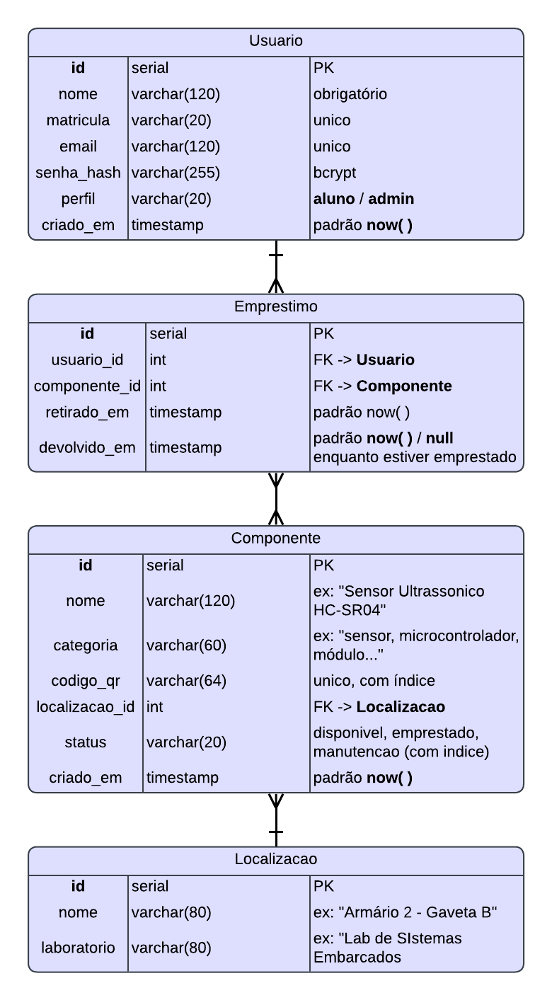

# Banco de Dados — Inventário Inteligente

Modelagem relacional e scripts SQL em PostgreSQL 16 para o controle de componentes, localizações, usuários e empréstimos do laboratório.

## Estrutura da pasta

| Arquivo | Descrição |
| --- | --- |
| `migrations/01_schema.sql` | Criação das tabelas `usuario`, `localizacao`, `componente` e `emprestimo`, constraints de integridade e índice de status. |
| `migrations/02_restricao_emprestimo.sql` | Índice único parcial (`idx_um_emprestimo_aberto_por_componente`) que impede mais de um empréstimo em aberto por componente. |
| `seeds/01_dados_iniciais.sql` | Carga inicial com 2 usuários de teste, 2 localizações, 3 componentes (nos status `emprestado`, `disponivel` e `manutencao`) e 1 empréstimo ativo. |
| `diagrama-er.png` | Diagrama entidade-relacionamento atualizado do banco. |

## Contrato com o back-end

* Qualquer alteração estrutural em tabelas, colunas ou restrições deve ser feita via **nova migration** (`03_...sql`) e comunicada previamente no grupo antes do merge (`Thiago → Pietro`).
* O contrato da API que consome esta base está documentado em [`docs/openapi.yaml`](../docs/openapi.yaml).

## Regras de integridade aplicadas

* **Preservação de histórico (`ON DELETE RESTRICT`):** Usuários e componentes vinculados a registros em `emprestimo` não podem ser removidos.
* **Exclusividade de empréstimo aberto:** O índice único parcial em `emprestimo (componente_id) WHERE devolvido_em IS NULL` bloqueia no nível do banco a abertura de dois empréstimos simultâneos para o mesmo item.
* **Campos obrigatórios e únicos:** `matricula`, `email` e `codigo_qr` possuem restrições `UNIQUE NOT NULL`; as chaves estrangeiras de `emprestimo` (`usuario_id` e `componente_id`) são `NOT NULL`.

## Como subir e inicializar o banco

1. Crie o arquivo de variáveis de ambiente (caso ainda não exista) e suba o contêiner do PostgreSQL:

   ```bash
   cp .env.example .env
   docker compose up -d db
   ```

   * **Host na rede Docker:** `db`
   * **Host local:** `localhost:5432`

2. Execute as migrations e o seed na ordem abaixo:

   **Linux / macOS / Git Bash:**

   ```bash
   cat database/migrations/01_schema.sql | docker compose exec -T db psql -U inventario -d inventario
   cat database/migrations/02_restricao_emprestimo.sql | docker compose exec -T db psql -U inventario -d inventario
   cat database/seeds/01_dados_iniciais.sql | docker compose exec -T db psql -U inventario -d inventario
   ```

   **Windows (PowerShell):**

   ```powershell
   Get-Content -Encoding UTF8 database/migrations/01_schema.sql | docker compose exec -T db psql -U inventario -d inventario
   Get-Content -Encoding UTF8 database/migrations/02_restricao_emprestimo.sql | docker compose exec -T db psql -U inventario -d inventario
   Get-Content -Encoding UTF8 database/seeds/01_dados_iniciais.sql | docker compose exec -T db psql -U inventario -d inventario
   ```

3. Verifique se as 4 tabelas e os registros iniciais foram criados corretamente:

   ```bash
   docker compose exec db psql -U inventario -d inventario -c "\dt" -c "SELECT id, nome, status FROM componente;"
   ```

4. **Resetar o banco do zero (opcional):**

   ```bash
   docker compose down -v
   docker compose up -d db
   ```

   *(Após o contêiner subir novamente, repita o passo 2.)*

## Usuários de teste (Seed)

| Perfil | E-mail | Matrícula | Senha |
| --- | --- | --- | --- |
| `aluno` | `aluno@furg.br` | `12345` | `senha123` |
| `admin` | `admin@furg.br` | `99999` | `senha123` |

> As senhas em `usuario.senha_hash` estão armazenadas com hash `bcrypt` válido (60 caracteres), compatível com a validação de login do back-end.

### Validar hash das senhas no banco

Para conferir os usuários inseridos e validar via `pgcrypto` que os hashes armazenados correspondem à senha `senha123`:

```bash
docker compose exec db psql -U inventario -d inventario -c "CREATE EXTENSION IF NOT EXISTS pgcrypto; SELECT id, email, perfil, (senha_hash = crypt('senha123', senha_hash)) AS senha_valida FROM usuario;"
```

*(O retorno `t` na coluna `senha_valida` confirma que o hash `bcrypt` bate com a senha de teste.)*

## Diagrama Entidade-Relacionamento

